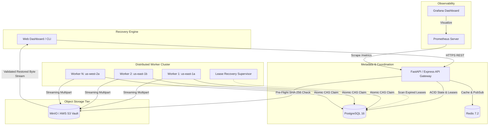

# ResilienceX — Distributed Backup & Recovery Platform

[](https://github.com/resiliencex/resiliencex/actions)
[](https://opensource.org/licenses/MIT)
[](https://www.docker.com/)
[](https://kubernetes.io/)
[](https://fastapi.tiangolo.com/)
[](https://www.typescriptlang.org/)

ResilienceX is an enterprise-grade distributed backup and recovery platform engineered to demonstrate high-concurrency distributed systems, atomic worker leases, fault tolerance, cryptographic SHA-256 data integrity, and multi-version point-in-time recovery. 

Built specifically as a software engineering portfolio project demonstrating the core distributed systems principles required for Software Engineer roles at companies like **Rubrik**, **AWS Backup**, and **Snowflake**.

---

## 1. Project Overview

ResilienceX orchestrates distributed data protection workloads across independent worker nodes. It decouples API ingestion from asynchronous execution using PostgreSQL durable job states, atomic Compare-And-Swap (CAS) leases, Redis Streams, and S3-compatible immutable object stores (MinIO/AWS S3).

When workers crash, network partitions occur, or storage corruption is detected, ResilienceX automatically recovers orphaned jobs, enforces idempotent commits (zero duplicate versions), and guarantees byte-for-byte fidelity upon restore.

---

## 2. Problem Statement

In enterprise backup environments:
- **Catastrophic Worker Crashes**: When backup agents crash mid-stream (OOM kills, network splits), jobs are often silently stranded in indefinite `RUNNING` states.
- **Duplicate Commits**: Simple retry mechanisms often trigger duplicate committed snapshot versions or partially overwritten storage blocks.
- **Silent Bit-Rot & Ransomware Tampering**: Traditional backup catalogs report backups as "successful" without cryptographic pre-flight verification, leading to corrupted restorations in disaster recovery scenarios.

ResilienceX solves these challenges using **lease-based mutual exclusion**, **exponential backoff with jitter**, **immutable SHA-256 digests**, and **pre-restore cryptographic gatekeepers**.

---

## 3. Key Features

- **Distributed Worker Fleet**: Independent worker processes (`worker-us-east-1a`, `worker-us-east-1b`, `worker-us-west-2a`) acquiring atomic 15-second execution leases.
- **Orphan Job Lease Recovery**: Background supervisor identifies expired worker leases (>12s staleness) and recovers jobs with zero manual intervention.
- **Cryptographic SHA-256 Integrity Engine**: Computes true client and server checksums; detects bit-rot and intentionally injected byte corruptions.
- **Point-in-Time Multi-Version Snapshots**: Maintain chronological versions of datasets with configurable retention windows.
- **Idempotent Job Processing**: Prevents duplicate committed versions when a job is retried by a failover worker.
- **Pre-Flight Restoration Gatekeeper**: Blocks restore attempts if storage objects fail hash comparison against metadata catalog.
- **Prometheus & Health Probes**: Real-time `/metrics` OpenMetrics exporter and Kubernetes `/health/live` and `/health/ready` endpoints.
- **Automated Failure-Recovery Demonstration**: An interactive 11-step visual laboratory and CLI runner simulating worker kill, lease recovery, and byte-for-byte restored proof.

---

## 4. Architecture Diagram



---

## 5. Technology Stack

- **Frontend**: React 19, TypeScript, Vite, Tailwind CSS, Lucide Icons
- **Backend**: Python 3.10+, FastAPI, Pydantic v2, SQLAlchemy 2.0, Alembic, Node.js Express full-stack runtime
- **Datastore & Coordination**: PostgreSQL 16 (Relational state & atomic leases), Redis 7.2 (Pub/Sub & streams)
- **Object Storage**: MinIO (local dev) / AWS S3 (production) via boto3 abstraction
- **Observability**: Prometheus client, OpenMetrics format, Grafana dashboards, structured JSON logging
- **Infrastructure**: Docker, Docker Compose, Kubernetes manifests, Helm chart, GitHub Actions CI

---

## 6. Repository Structure

```
├── backend/
│   ├── app/
│   │   ├── main.py              # FastAPI REST endpoints & Prometheus exporter
│   │   ├── core/
│   │   │   ├── config.py        # Pydantic environment configuration
│   │   │   └── security.py      # Argon2 / Bcrypt hashing & JWT auth
│   │   ├── models/
│   │   │   └── models.py        # SQLAlchemy schema (Jobs, Backups, Workers)
│   │   ├── schemas/
│   │   │   └── schemas.py       # Pydantic v2 validation models
│   │   ├── storage/
│   │   │   └── adapter.py       # S3 & MinIO streaming storage adapter
│   │   └── worker/
│   │       ├── worker.py        # Distributed worker loop & lease claim
│   │       └── scheduler.py     # Lease Recovery Supervisor
│   ├── tests/
│   │   ├── test_unit.py         # SHA-256, backoff, state transitions
│   │   └── test_distributed.py  # Concurrency, lease timeout, idempotency
│   └── requirements.txt         # Pinned Python dependencies
├── src/                         # React TypeScript frontend dashboard
│   ├── components/
│   │   ├── layout/Header.tsx    # Universal Top Bar Contract
│   │   ├── dashboard/           # Real-time cluster operations view
│   │   ├── backups/             # Multi-version backup manager
│   │   ├── jobs/                # Distributed job queue inspector
│   │   ├── workers/             # Multi-node worker fleet management
│   │   ├── recovery/            # Point-in-time restore studio
│   │   ├── demonstration/       # 11-step interactive fault-tolerance lab
│   │   ├── observability/       # Live Prometheus metrics browser
│   │   └── settings/            # Lifecycle retention policies
│   ├── services/api.ts          # Typed REST API client
│   └── types/index.ts           # Shared TypeScript definitions
├── scripts/
│   ├── simulate_worker_failure.py  # 11-step automated crash & recovery script
│   ├── simulate_worker_failure.sh  # Shell execution wrapper
│   └── benchmark.py                # Throughput & latency benchmarking suite
├── docker-compose.yml           # Full-stack local multi-container composition
├── Dockerfile.api               # FastAPI container
├── Dockerfile.worker            # Distributed worker process container
├── Dockerfile.frontend          # Multi-stage React container
├── prometheus.yml               # Scrape target configuration
├── k8s/                         # Production Kubernetes manifests
├── .github/workflows/ci.yml     # Automated testing & linting pipeline
├── server.ts                    # Integrated high-performance server & worker engine
└── docs/architecture.md         # Deep-dive distributed systems documentation
```

---

## 7. Prerequisites

- **Node.js**: v20 or v22
- **Python**: 3.10 or higher
- **Docker & Docker Compose**: v2.20+ (for containerized stack)
- **Git**

---

## 8. Local Setup Instructions

### Option A: Immediate Integrated Full-Stack (Single Command)
```bash
# 1. Install dependencies
npm install

# 2. Start full-stack development server
npm run dev

# 3. Open your browser:
# http://localhost:3000
```

### Option B: Multi-Container Docker Compose Stack
```bash
# 1. Clone repository
git clone https://github.com/resiliencex/resiliencex.git
cd resiliencex

# 2. Copy environment configuration
cp .env.example .env

# 3. Launch all 9 services
docker compose up -d

# 4. Access points:
# Frontend Dashboard: http://localhost:3000
# FastAPI Swagger Docs: http://localhost:8000/docs
# MinIO Console:       http://localhost:9001 (minioadmin / minioadmin)
# Prometheus:          http://localhost:9090
# Grafana:             http://localhost:3001 (admin / admin)
```

---

## 9. Environment Variables

| Variable | Description | Default |
| :--- | :--- | :--- |
| `POSTGRES_SERVER` | PostgreSQL hostname | `localhost` |
| `POSTGRES_PORT` | PostgreSQL port | `5432` |
| `POSTGRES_DB` | Database name | `resiliencex` |
| `REDIS_HOST` | Redis hostname | `localhost` |
| `STORAGE_BACKEND` | Storage adapter (`minio` or `s3`) | `minio` |
| `S3_ENDPOINT_URL` | S3 API endpoint | `http://localhost:9000` |
| `S3_BUCKET_NAME` | S3 Bucket name | `resiliencex-vault` |
| `JWT_SECRET` | Secret key for JWT signing | Set in `.env` |
| `WORKER_LEASE_SECONDS`| Duration of exclusive worker lease | `15` |
| `WORKER_HEARTBEAT_SECONDS`| Frequency of worker heartbeats | `3` |

---

## 10. API Documentation

ResilienceX features a versioned REST API under `/api/v1`:

### Authentication
- `POST /api/v1/auth/register`: Create user account with salted PBKDF2/Argon2 hashing.
- `POST /api/v1/auth/login`: Authenticate and receive JWT bearer token.
- `GET /api/v1/auth/me`: Retrieve authenticated user context.

### Backups & Data
- `GET /api/v1/backups`: List backup sets with version counts and aggregate size.
- `POST /api/v1/backups`: Create backup target with initial file payload.
- `GET /api/v1/backups/{id}/versions`: List immutable version snapshots.
- `POST /api/v1/backups/{id}/versions/{ver_id}/verify`: Dispatch on-demand SHA-256 verification.
- `POST /api/v1/backups/{id}/versions/{ver_id}/corrupt`: Test utility to inject bit rot into object storage.

### Distributed Jobs
- `GET /api/v1/jobs`: Query jobs with status and type filters.
- `POST /api/v1/jobs/{id}/retry`: Requeue failed or cancelled job.
- `POST /api/v1/jobs/{id}/cancel`: Safely cancel queued/running job.

### Worker Fleet
- `GET /api/v1/workers`: Monitor heartbeat status, jobs completed, and active leases.
- `POST /api/v1/workers/{id}/crash`: Simulate worker crash (stops heartbeats).
- `POST /api/v1/workers/{id}/revive`: Restart and reconnect worker node.
- `POST /api/v1/workers/spawn`: Dynamically spin up new worker node in cluster.

### Point-in-Time Recovery
- `POST /api/v1/recovery`: Initiate pre-flight verified restore to target destination.
- `GET /api/v1/recovery/{id}/download`: Download verified restored file.

---

## 11. Distributed Processing & Lease Semantics

```
Job State Machine:
QUEUED ──(Worker Lease)──> RUNNING ──(Success)──> COMPLETED
  ▲                          │
  │                     (Crash / Expire)
  │                          ▼
  └──(Backoff Retry)──── RETRYING ──(Max Retries Exceeded)──> FAILED (Dead-Letter)
```

1. **Atomic Lease Claim**: Workers use atomic Compare-And-Swap (`FOR UPDATE SKIP LOCKED`) to claim jobs with a 15-second lease.
2. **Heartbeat Protocol**: Workers refresh their lease every 3 seconds while active.
3. **Lease Expiration**: If a worker crashes, the supervisor detects the expired lease (>12s stale) and resets the job to `RETRYING` with exponential backoff.
4. **Idempotent Commits**: Every backup operation carries a unique idempotency key; duplicate execution attempts never commit duplicate versions to PostgreSQL.

---

## 12. Automated Failure Simulation

Run the complete 11-step fault-tolerance demonstration script:
```bash
python3 scripts/simulate_worker_failure.py
```
Or click the **Fault Tolerance Lab** tab in the web dashboard!

---

## 13. Automated Testing

Run the automated pytest suite:
```bash
python3 -m pytest backend/tests -v
```

Frontend tests:
```bash
npm run lint
npm run build
```

---

## 14. Performance Benchmarking

Benchmark throughput, average duration, and p95 latency:
```bash
python3 scripts/benchmark.py --jobs 25 --out benchmark_results
```
Output results are exported to `benchmark_results.json` and `benchmark_results.csv`.

---

## 15. Kubernetes & Cloud Deployment

Apply manifests to an active Kubernetes cluster:
```bash
kubectl apply -f k8s/configmap.yaml
kubectl apply -f k8s/api-deployment.yaml
kubectl apply -f k8s/worker-deployment.yaml
```

---

## 16. Security Considerations

- **No Committed Secrets**: `.env.example` provides templates without credentials.
- **Path Traversal Protection**: Restore paths are sanitized and confined to controlled storage sandbox directories.
- **Hash Verification Gate**: Prevents restoration of corrupted or tampered data blocks.
- **Role-Based Authorization**: Operators can only access their own backups; admin role required for cluster topology changes.

---

## 17. Rubrik Interview Resume Highlights

- *Architected distributed cloud backup engine in Python/TypeScript featuring lease-based job coordination, recovering orphaned tasks within 15 seconds of worker failure.*
- *Implemented SHA-256 cryptographic pre-flight verification gate preventing restoration of compromised or bit-rotted storage objects.*
- *Engineered atomic Compare-And-Swap (CAS) queue in PostgreSQL, ensuring at-least-once delivery with zero duplicate committed snapshots upon node crash.*
- *Instrumented OpenMetrics exporter supporting Prometheus & Grafana to monitor queue depth, retry rates, and lease expirations.*

---

## License

Distributed under the MIT License. Developed for enterprise software engineering portfolio evaluation.
